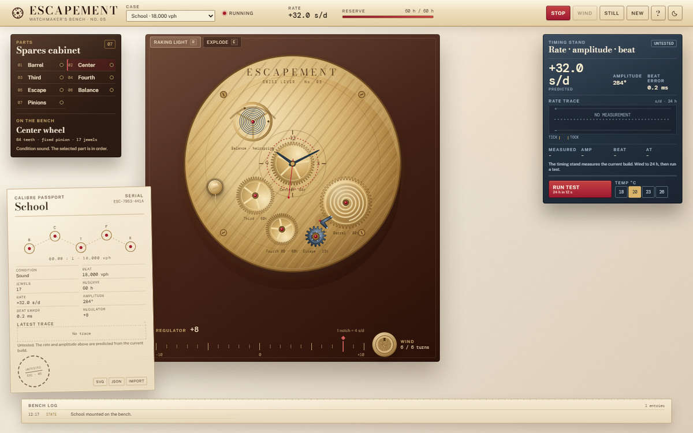
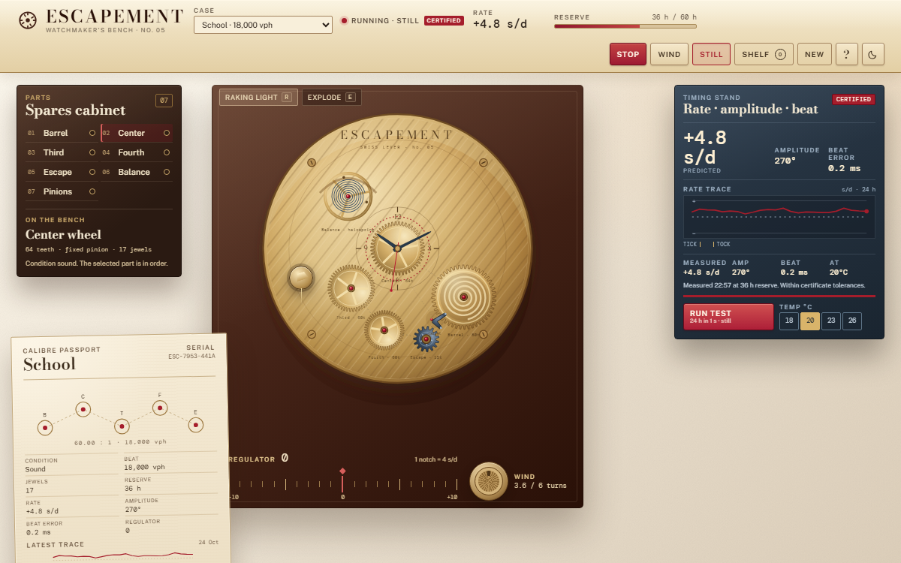
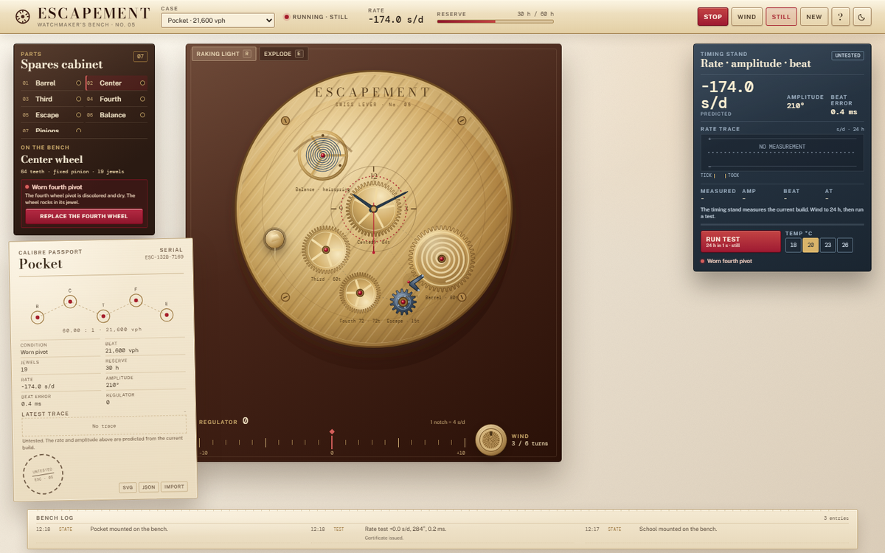
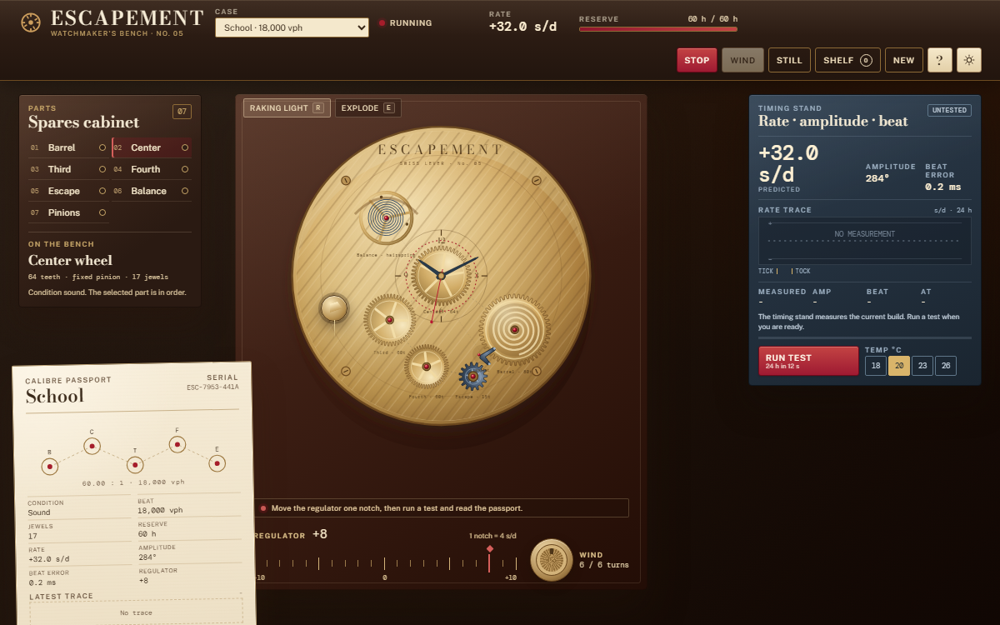
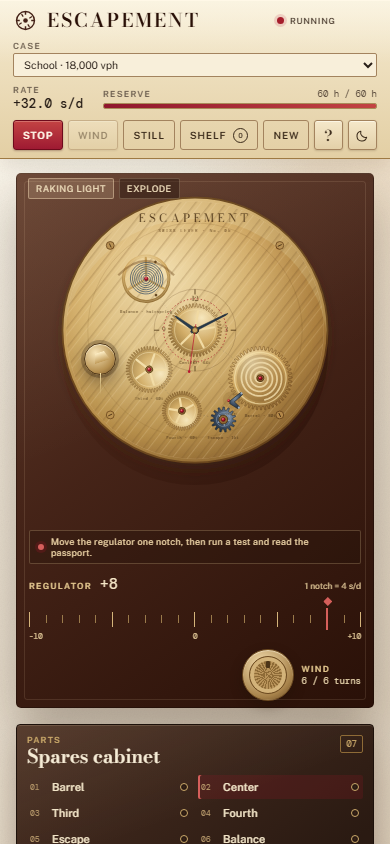

# ESCAPEMENT

A watchmaker's bench in the browser. Assemble a mechanical movement, wind the mainspring, turn the regulator, diagnose a fault, and earn a bench certificate.

Silent by design. Deterministic horology. No account, no backend, no network requests after load.

## Live Demo

**https://escapement-two.vercel.app**

> Client-side only. The bench, saved calibres, and test history live in your browser. No account, no backend, no network after load.

## Screenshots

## The bench

- **School** is a slow 18,000 vph lever movement. It runs, but the regulator is set fast. Eight notches bring it back.
- **Pocket** is a 21,600 vph pocket movement with a worn fourth pivot. The rate is far out, the amplitude is low, and the evidence is under the raking light.
- **Marine** is a clean 28,800 vph movement with no wind and no certificate. Wind it, test it, regulate it, certify it.

New builds can start clean or with one of five seeded conditions: a magnetized hairspring, a worn pivot, a set mainspring, a beat error, or a loose cannon pinion.

## What you can do

- Inspect an isometric SVG movement. Select any wheel, lift the movement into an exploded view, and move the raking light across the plate.
- Fit wheels and pinions from the spares cabinet. Center to fourth must stay 60:1. The escape wheel must agree with the nominal beat. Break either and the movement stops, with the break shown in the train schematic.
- Turn the regulator one notch at a time. Each notch is four seconds per day.
- Drag the crown or press Wind. Six mainspring turns give sixty hours of reserve.
- Run the timing stand. It spins the movement through 24 simulated hours in 12 seconds, draws a rate trace on paper, and reports rate, amplitude, and beat error. The test consumes 24 hours of reserve.
- Repair the cause, not the symptom. Each fault has a physical fix in the cabinet.
- Earn a bench certificate when the measured rate is within plus or minus ten seconds per day, the amplitude is 250 to 320 degrees, and the beat error is under 0.5 milliseconds.
- Export the calibre passport as SVG, the build as JSON, and import a build back.
- Switch the bench between day and night with the lamp toggle or the L key.

Everything stays in this browser. The bench persists to IndexedDB with a localStorage fallback.

## Controls

| Input | Action |
| --- | --- |
| Click a wheel | Inspect it in the cabinet |
| Drag the crown | Wind; one full turn per revolution |
| Regulator notches | Four seconds per day per notch |
| `R` | Raking light on or off |
| `E` | Exploded movement |
| `W` | Wind one turn |
| `T` | Run the timing test |
| `C` | Go to the calibre passport |
| `L` | Switch between day and night |
| `Space` | Start or stop the movement |
| `?` | Bench note and model limits |
| `Escape` | Close the bench note |

